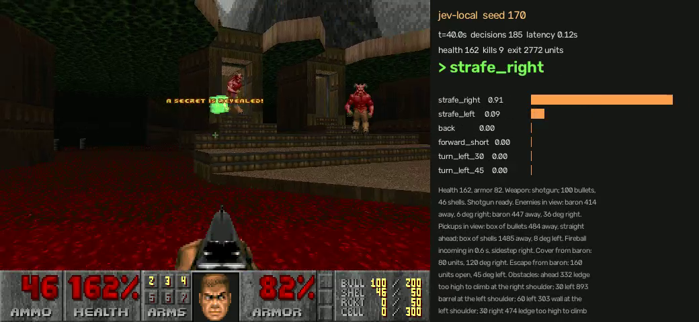

# doom-jev

A 4B language model plays DOOM in real time on a home GPU and chooses every move itself. It clears E1M8, the episode-1 finale with two Barons of Hell, on 8 of 20 unseen seeds, about as often as its own teacher manages at the same reaction speed.



- **Model:** Qwen3.5-4B + LoRA, local RTX 3090, one forward pass per decision, ~90 ms, ~4 decisions per second. The game runs at full speed (35 tics/s) and never waits.
- **Input:** text, no pixels. Code turns the game state into a short description: enemies with distance and angle, walls and doors, the route to the next goal, shotgun reload state, incoming fireballs, cover.
- **Output:** one of 26 fixed commands (move, strafe, turn by 5-90 degrees, fire, turn-and-fire, use), read from the model's next-token probabilities over option letters (the [Simple Jev](https://github.com/featherless-ai/simple-jev) method). The model never writes text.
- **Learning:** it copies a rule-based teacher, then plays on its own and the teacher relabels the positions it reached (DAgger).

## Results (2026-10-19, skill 3 "Hurt me plenty")

| Level | Jev (student) | Teacher (rules) |
|---|---|---|
| E1M1 | 20/20 held-out seeds, median 29.9 s | 20/20, median 23.5 s |
| E1M2 | 13/20, median 75.4 s | 10/10, median 58.7 s |
| E1M8 | 8/20 unseen seeds, fastest 133.9 s | ~70% instant, ~45% with Jev's 100 ms delay |
| E1M3-E1M7 | not trained yet | routes planned on every map; E1M3 often, E1M4 ~2/8, E1M5-E1M7 not yet |

E1M8 starts from a stand-in for what a player carries out of E1M7 (shotgun, chaingun, 100 bullets, 30 shells). The goal is one model playing E1M1 to E1M8 in one go, with health, armor, weapons and ammo carried from each exit to the next level (`loadout.py`, `campaign.py`).

## What made E1M8 work

The first E1M8 teacher, tuned with instant reactions, cleared ~70%. With 50 ms of added delay it cleared 0%. A student that needs 90 ms per decision cannot copy tactics that only work at 0 ms, so the teacher was rebuilt and measured with a 100 ms delay until it cleared again:

- fire only when the shotgun is ready (one shot per 37 tics), dodge during the reload, stop and aim 0.35 s before the next shot;
- keep 330-520 units from the Barons; when cornered, escape toward open space instead of the nearest gap;
- dodge fireballs from their measured velocity, before they hit;
- treat barrels, the lift state and the line of fire as facts in the text.

The student trained on that teacher in four rounds (teacher games, then three DAgger rounds, about 1 h each on the 3090) and reached 8/20.

## How a command happens

```
ViZDoom, 35 tics/s, never paused
   |  engine variables + WAD map geometry
   v
perception.py   facts as text: health, armor, ammo, shotgun ready/reloading; enemies and pickups
   |            (distance, angle, crosshair, line of fire); body-width rays (wall, door, lift,
   |            ledge, barrel); incoming fireballs; cover and escape spots; route compass
   v
Jev (local)     options + state -> one forward pass of Qwen3.5-4B + LoRA (CUDA graphs)
   |            -> softmax over 26 option letters -> command
   v
executor.py     plays the command as a fixed key macro; the next command cancels it
```

| Component | Does | Decides? |
|---|---|---|
| Jev (model) | picks every command | yes |
| Perception | game state to text, facts only | no |
| Route compass | bearing to the next subgoal along an A* path over the WAD map, computed off the game loop | no, a sensor reading |
| Progression planner | order of subgoals: keys, switches, lifts, weapon and supply detours, exit | no, it sets the compass target |
| Executor | fixed button pattern per command | no |
| Weapon select | best weapon with ammo (shotgun first) | fixed rule, like Doom's auto-switch |

## How it learns

```
expert.py (rules over the same text) --labels--> every recorded state
   states from: teacher games, teacher games with 50-100 ms delay, the student's own games (DAgger)
        --> train_fast.py: LoRA on Qwen3.5-4B, cross-entropy on the teacher's option letter
        --> fast_server.py: base model + adapter on localhost:8012
```

The teacher is allowed to get better; the student only ever sees text and labels.

## Run (Windows, PowerShell)

```powershell
.\scripts\setup.ps1 -Cuda                      # venvs, WAD, CUDA PyTorch, ffmpeg under C:\tmp\jev-doom
python -m jevdoom.compare --arms rules rules-lag-100 --map E1M8 --seeds 1 2 3 4 --jobs 4 --loadout nominal --out runs\teacher
python -m jevdoom.dataset --expert <state files> --dedupe --out data\train.jsonl
python -m jevdoom.train_fast --data data\train.jsonl --model Qwen/Qwen3.5-4B --out C:\tmp\jev-doom\models\run --steps 300 --grad-ckpt
.\scripts\eval_student.ps1 -Adapter C:\tmp\jev-doom\models\run\best -Out runs\eval -Map E1M8 -Loadout nominal -Video
python -m jevdoom.report runs\eval             # HTML viewer: video synced to every decision
python -m jevdoom.campaign --arm rules --maps E1M1 E1M2 E1M3 --seed 1 --out runs\campaign
```

Game-side modules use `C:\tmp\jev-doom\venv`; training and serving use `C:\tmp\jev-doom\venv-rocm` (CUDA on the PC despite the name).

| Module | Purpose |
|---|---|
| `perception`, `executor`, `play`, `env` | text description, key macros, real-time loop |
| `expert` | rule-based teacher and reference arm |
| `progression`, `wadmap` | subgoal planner and A* routes over the WAD map |
| `loadout`, `campaign` | carry state between levels, chain E1M1 to E1M8 |
| `compare` | live runs per arm, seed and map, in parallel (`--jobs`) |
| `dataset`, `train_fast`, `fastjev`, `fast_server` | labels to records, LoRA trainer, one-pass scorer with CUDA graphs, server |
| `report`, `sbs_video` | HTML viewer, student-vs-teacher videos |

`data/`, `runs/`, `models/` are git-ignored. Heavy files live under `C:\tmp\jev-doom`.

Current state and next steps: [docs/HANDOFF.md](docs/HANDOFF.md). Experiment design and all numbers: [EXPERIMENT.md](EXPERIMENT.md). The earlier path, including the laptop phase and what failed: [docs/ARCHITECTURE.md](docs/ARCHITECTURE.md).
